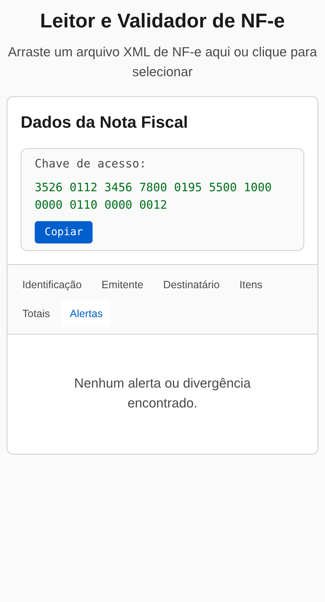

# Leitor e Validador de NF-e

> **Demonstração:** https://hey-pablo.github.io/nfe-leitor/

Página que lê o XML de uma NF-e (modelo 55), mostra a nota em formato legível e aponta problemas: chave de acesso inválida, CNPJ com dígito errado e totais que não batem com os itens. Tudo roda no navegador, e nenhum arquivo sai da máquina de quem usa.



## Problema

Conferir um XML de NF-e à mão é lento e propenso a erro: são centenas de tags, e coisas como o dígito verificador da chave ou a soma dos itens ninguém confere de cabeça. No suporte a ERP isso aparece o tempo todo (nota rejeitada, total diferente, chave digitada errada).

## Solução

Arrastar ou selecionar o XML mostra, em menos de um segundo, o cabeçalho, emitente e destinatário, itens, totais e protocolo. Um selo indica se a chave é válida (com botão para copiá-la) e uma lista de alertas traz cada divergência com o valor esperado e o encontrado. Arquivos que não são XML ou não são NF-e geram mensagem clara, sem travar a página.

## Como rodar

O site é estático. Para abrir localmente:

```bash
python3 -m http.server 8080
# abra http://localhost:8080 e use os XMLs da pasta exemplos/
```

Testes (Node 20 ou superior):

```bash
npm install
npm test             # lógica: chave, CNPJ, somas e parser (7 testes)
npx playwright install chromium
npm run test:e2e     # interface no navegador, desktop e celular
```

## Estrutura

```
index.html, css/estilo.css
js/parser.js      # XML -> objeto (ide, emit, dest, itens, totais, protocolo)
js/validador.js   # chave (módulo 11), CNPJ, somas
js/render.js      # monta cabeçalho, tabelas e alertas
js/main.js        # upload, arrastar e soltar, orquestração
exemplos/         # XMLs fictícios: válido, total divergente, chave inválida
tests/            # testes da lógica (node --test)
e2e/              # testes da interface (Playwright)
```

## Decisões técnicas

- **JavaScript puro com módulos ES**, sem framework nem dependência em tempo de execução.
- **Privacidade por construção**: o código não faz nenhuma requisição com o conteúdo do arquivo, e um teste automatizado confere isso.
- **Funções puras para as regras fiscais**, testáveis sem navegador. O parser recebe o `DOMParser` por parâmetro, então os testes rodam em Node.
- **`getElementsByTagName`** para ler as tags, que funciona com o namespace padrão do XML da NF-e.
- **Texto do arquivo entra na tela por `textContent`**, nunca como HTML, para um XML malicioso não executar código.
- **Chave de acesso**: 44 dígitos, módulo 11 com pesos de 2 a 9 da direita para a esquerda; resto 0 ou 1 gera dígito 0, senão 11 menos o resto.

## Limitações

- Valida a estrutura e os cálculos, não consulta a SEFAZ: uma chave com dígito correto não prova que a nota existe nem está autorizada.
- Cobre NF-e modelo 55; não lê NFC-e, CT-e nem eventos.
- Não valida assinatura digital nem o schema XSD completo.
- Os XMLs de exemplo são inteiramente fictícios.

## Onde a IA entrou

O código e os testes foram escritos com assistência de IA e revisados; o cálculo do dígito verificador da chave foi conferido por um cálculo independente.

## Próximos passos

Validar contra o XSD, suportar NFC-e, exportar a leitura para CSV e destacar tributos por item.
